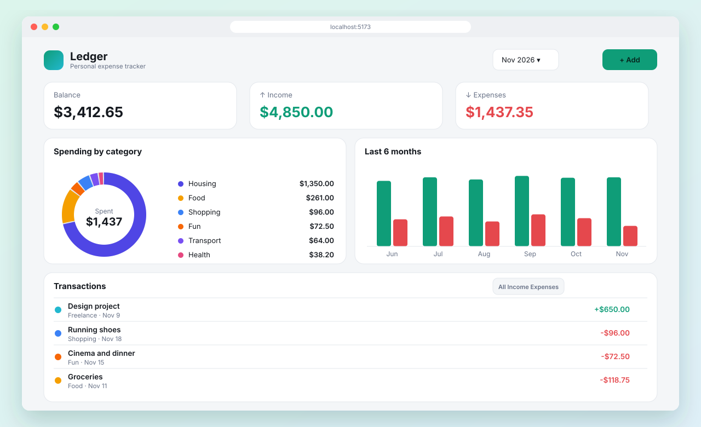

<p align="center">
  
</p>
<p align="center"><sub>Preview: design illustration of the dashboard (light theme).</sub></p>

# Ledger: React Expense Tracker

A modern, free personal finance template built with **React 18**, **TypeScript** and **Vite**. No UI library and no chart library: hand-written SVG charts and a small, readable codebase you can drop into your own product.

## Features

- **Summary cards**: balance, income and expenses for the selected month or all time
- **Spending by category** donut chart with legend
- **Last 6 months** income vs expenses bar chart
- **Transactions list** with search, income / expense filter and delete
- **Add transactions** in an accessible native `<dialog>` with validation
- **CSV export** of the filtered list (properly escaped)
- **Saved in the browser** (localStorage), safe when storage is unavailable
- **Light and dark themes**, remembered between visits, no flash on load
- **Responsive** layout and keyboard friendly controls
- **Zero dependencies** beyond React

## Quick start

```bash
git clone https://github.com/lenivalestevao/react-expense-tracker.git
cd react-expense-tracker
npm install
npm run dev
```

| Command | What it does |
| --- | --- |
| `npm run build` | Type-check and create a production build in `dist/` |
| `npm run preview` | Serve the production build locally |
| `npm test` | Run the unit tests (Vitest) |
| `npm run typecheck` | TypeScript check only |

## Project structure

```
src/
  App.tsx                 State, filters and layout
  types.ts                Transaction, categories and filters
  styles.css              Design tokens (light and dark) and all styles
  components/
    charts.tsx            Donut and MonthBars (pure SVG)
    TxDialog.tsx          Add form with validation
    ui.tsx                Icons and category colors
  lib/
    ledger.ts             Pure functions: totals, grouping, series, filters, CSV, money
    ledger.test.ts        Unit tests
    storage.ts            Validated localStorage load / save
    theme.ts              Theme hook with persistence
  data/seed.ts            Demo data for the last four months
```

## Make it yours

- **Categories**: edit `CATEGORIES` in `src/types.ts` and the colors in `src/components/ui.tsx`.
- **Currency**: change the formatter in `money()` inside `src/lib/ledger.ts`.
- **Backend**: `ledger.ts` is pure, so you can feed it data from your API instead of localStorage.
- **Storage key**: `ledger-transactions-v1` in `src/lib/storage.ts`. Bump it if you change the data shape.

## License

MIT. Free for personal and commercial use.
